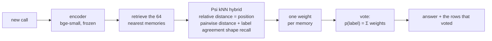

<p align="center">
  
</p>

<h3 align="center">The world's first workflow language model.</h3>

<p align="center">
  <a href="LICENSE"></a>
  
  
  
  
</p>

<p align="center">
  <b>Up to +6.5 points more accurate than a tuned Hopfield memory, on data it has never seen.</b>
</p>

---

Agents answer the same kinds of questions thousands of times a day: *categorize this transaction*, *does this invoice match*, *is anything odd here*. Each answer is a call to a large language model that costs money and seconds.

**Psi answers them from memory instead.** It keeps a workflow's past decisions as a memory of `(embedding, label)` rows and recalls from it with a novel neural kNN hybrid: it retrieves the nearest past decisions like kNN, then a learned multi-head network trained for exactly one job decides which of them should vote, and how much. There's no LLM call and no per-workflow training. Point Psi at a workflow's memory and it answers.

A language model reads a sequence of words. **A workflow language model reads a sequence of past decisions**, ordered by how close each one is to the call in front of it.

## Why Psi

| | |
|---|---|
| **Zero-shot across workflows** | Psi never sees label names or ids, only whether memories agree with each other. One pretrained model serves every step of every workflow. |
| **Learning is appending** | A new decision becomes a new memory row and counts on the very next call. No gradient steps, no retraining. |
| **Forgetting is deleting** | Remove a row and its influence is gone, everywhere. That's right-to-be-forgotten without a training run. |
| **Every answer shows its sources** | Psi's output is a weight per past decision, so each answer names the exact rows that voted for it. |
| **Drop-in** | Psi reuses the embeddings your memory already stores. Nothing to re-embed. |

## How it works



- **Relative distance is the positional encoding.** A memory has no index position. Its position is its distance from the query, encoded with sinusoidal frequencies, so the closest memories are "first".
- **Memories read each other.** Every layer lets the retrieved neighbors exchange information; Psi biases each head's recall by the distance between two memories and by whether they share a label. Psi sees clusters, outliers and disagreement directly.
- **Imbalance-aware.** Each memory token knows how common its label is in the memory and how big the memory is, so Psi learns its own correction for skewed labels.
- **The vote.** `p(label | call) = Σ softmax(Psi(call, memories))ᵢ` over the retrieved memories carrying that label.

| Architecture | |
|---|---|
| Parameters | 204M |
| Neural kNN hybrid | 16 layers, width 1024, 16 heads |
| Memories read per call | 64 |
| Encoder (frozen, not included) | [BAAI/bge-small-en-v1.5](https://huggingface.co/BAAI/bge-small-en-v1.5) |
| Weights | `model.safetensors`, fp16, via Git LFS |

## Trained on diverse data

Psi is pretrained for 15 minutes on one H100 across 20 public text-classification datasets spanning news, banking and assistant intents, emotions, questions, finance, reviews, toxicity, medical text, spam and encyclopedic topics, plus real agent workflows from bookkeeping and accounting. Every training episode is a different world: a random memory of 100 to 5,000 decisions, its own label set, its own imbalance, and queries from outside the memory. Some episodes mimic repeat traffic. Whole datasets are held out to test generalization to data Psi has never seen.

## Quickstart

```bash
git lfs install && git clone https://github.com/aidenhongg/psi && cd psi
pip install torch safetensors sentence-transformers
```

```python
import torch
from safetensors.torch import load_file
from sentence_transformers import SentenceTransformer
from psi import Psi, predict

psi = Psi(d=1024, layers=16, heads=16)
psi.load_state_dict({k: v.float() for k, v in load_file("model.safetensors").items()})
psi.eval()

enc = SentenceTransformer("BAAI/bge-small-en-v1.5")
labels = ["Travel", "Hosting", "Meals"]
memory = ["UBER *TRIP 8.12", "AWS us-east-1 412.00", "STARBUCKS 5.40", "DELTA AIR 312.10", "GCP compute 88.00"]
memory_labels = [0, 1, 2, 0, 1]

M = torch.tensor(enc.encode(memory, normalize_embeddings=True))
Q = torch.tensor(enc.encode(["LYFT RIDE 14.20"], normalize_embeddings=True))
p = predict(psi, Q, M, torch.tensor(memory_labels), n_labels=len(labels))
print(labels[p.argmax()], p)
```

## Train your own

```bash
pip install modal && modal run psi.py --budget-s 900
```

One H100. The script downloads and embeds the datasets, pretrains Psi, evaluates it against a tuned Hopfield memory read on held-out data, and writes `model.safetensors`.

## Built for Dreaming

Psi is the memory behind [Dreaming](https://github.com/wilyan09007/Dreaming), which turns an agent's expensive model calls into certified, replayable stand-ins.

## Citation

```bibtex
@software{psi2026,
  title  = {Psi: a workflow language model},
  year   = {2026},
  url    = {https://github.com/aidenhongg/psi}
}
```

## License

Apache-2.0
