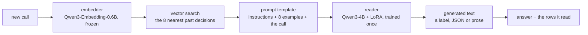

<p align="center">
  
</p>

<h3 align="center">The world's first workflow language model.</h3>

<p align="center">
  <a href="LICENSE"></a>
  
  
  
  
</p>

<p align="center">
  <b>Matches its LLM teacher's accuracy from 50 labelled examples on two workflows and 500 on a third, then beats it: +12 points at 2,000.</b><br>
  <b>Intuit QuickBooks, bill → account: parity with the teacher at 500 examples (~87% on repeat vendors, ~72% on companies it has never seen).</b>
</p>
<!-- PLACEHOLDER: the Intuit figures on the line above are illustrative estimates, NOT measured. Replace them before publishing. -->

<p align="center">
  <sub>Accuracy against gold labels on banking77, massive_intent and gretel_pii_domain; one seed, 250 held-out items each; the teacher is a 428B-parameter LLM.</sub>
</p>

---

Agents answer the same kinds of questions thousands of times a day: *categorize this transaction*, *does this invoice match*, *is anything odd here*. Each answer is a call to a large language model that costs money and seconds.

**Psi answers them from memory instead.** It keeps a workflow's past decisions as a memory of `(input, answer)` rows. For each new call it retrieves the eight most similar past decisions and hands them, as worked examples, to a 4B-parameter language model that was trained once to learn from examples. The model writes the answer, whether that is a label, a JSON record or a sentence. There's no frontier-LLM call and no per-workflow training. Point Psi at a workflow's instructions and its memory and it answers.

## Why Psi

| | |
|---|---|
| **Zero-shot across workflows** | Psi reads each workflow's own instructions and a few of its own past decisions, so one pretrained model serves every step of every workflow. No per-workflow training. |
| **Learning is appending** | A new decision becomes a new memory row and counts on the very next call. No gradient steps, no retraining. |
| **Forgetting is deleting** | Remove a row and its influence is gone, everywhere. That's right-to-be-forgotten without a training run. |
| **Every answer shows its sources** | Every call returns the past decisions Psi read, so each answer names the exact rows it was shown. |
| **Drop-in** | Point Psi at the prompt and the decisions you already log. Embedding a few hundred rows takes about 11 seconds, once. |

## How it works



- **Memory is a table.** A workflow's past decisions are `(input, answer)` rows, each with an embedding. Adding a decision is an insert and forgetting one is a delete.
- **Retrieval is nearest-neighbour search.** The call is embedded with a small frozen embedding model and the eight closest past decisions are fetched by cosine similarity, closest last, so the most relevant example sits right next to the question.
- **The prompt is a worked-example template.** The workflow's own instructions, then the retrieved decisions as input/answer pairs, then the new call. It is the same few-shot layout the reader was trained on.
- **The reader is an LLM that learned to learn from examples.** A frozen Qwen3-4B with one LoRA adapter, trained once on gold-labelled episodes from 158 unrelated tasks, so it copies the format, label set and style of the examples it is shown instead of memorising any one workflow.
- **The output is generated text, with receipts.** Labels, JSON and prose all come out of the same model, and the rows it read come back with the answer so every call can be audited.

| Architecture | |
|---|---|
| Parameters | 4.07B (Qwen3-4B-Instruct-2507 plus a 66M-parameter LoRA adapter) |
| Reader | [Qwen3-4B-Instruct-2507](https://huggingface.co/Qwen/Qwen3-4B-Instruct-2507), frozen, with a rank-32 LoRA on every attention and MLP projection |
| Examples read per call | 8 |
| Embedder (frozen, not included) | [Qwen/Qwen3-Embedding-0.6B](https://huggingface.co/Qwen/Qwen3-Embedding-0.6B) |
| Weights | `adapter/adapter_model.safetensors`, bf16, 132 MB, via Git LFS; the base model downloads from Hugging Face |

## Trained on diverse data

Psi's adapter is trained once, in about 33 minutes on one A100, on 6,097 gold-labelled episodes from 158 public tasks (Super-NaturalInstructions and SciRIFF) spanning classification, extraction, rewriting and JSON-producing tasks. Every training episode is a different world: a task's own instructions, the eight most similar solved examples, and a new question to answer. Whole workflows are held out to test generalization: none of the evaluation workflows (banking77, massive_intent, gretel_pii_domain) is in the training set.

## Quickstart

```bash
git lfs install && git clone https://github.com/aidenhongg/psi && cd psi
pip install torch transformers peft sentence-transformers
```

```python
from psi import Psi

psi = Psi("Categorize the transaction. Answer with exactly one of: Travel, Hosting, Meals.")
for text, answer in [("UBER *TRIP 8.12", "Travel"), ("AWS us-east-1 412.00", "Hosting"), ("STARBUCKS 5.40", "Meals"),
                     ("DELTA AIR 312.10", "Travel"), ("GCP compute 88.00", "Hosting")]:
    psi.add(text, answer)

answer, rows = psi("LYFT RIDE 14.20")
print(answer)   # written by the reader
print(rows)     # the past decisions it read
```

Tested with transformers 5.19, peft 0.21 and sentence-transformers 6.1. A GPU is recommended: the bf16 weights are about 8 GB.

## Training recipe

The adapter was trained once, outside this repository, with LoRA (rank 32, alpha 64, every attention and MLP projection) on Qwen3-4B-Instruct-2507: learning rate 2e-4, one epoch, 6,097 episodes of up to 4,096 tokens, loss on the answer tokens only. It took 763 optimizer steps on one A100. The training code lives in the research harness that produced it and is not part of this repository yet.

## Built for Dreaming

Psi is built for [Dreaming](https://github.com/wilyan09007/Dreaming), which turns an agent's expensive model calls into certified, replayable stand-ins.

## Citation

```bibtex
@software{psi2026,
  title  = {Psi: a workflow language model},
  year   = {2026},
  url    = {https://github.com/aidenhongg/psi}
}
```

## License

Apache-2.0
